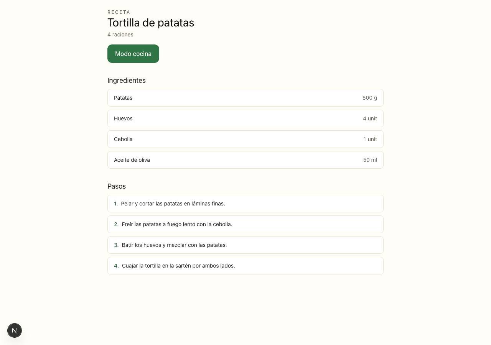
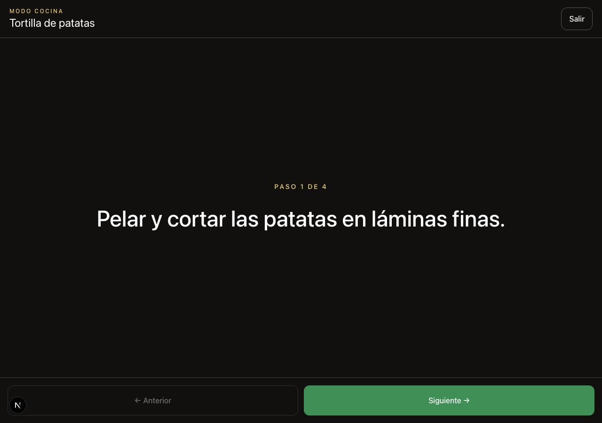
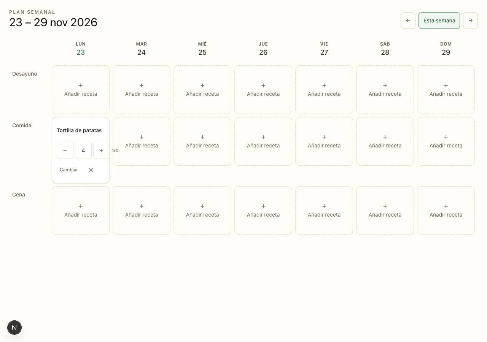
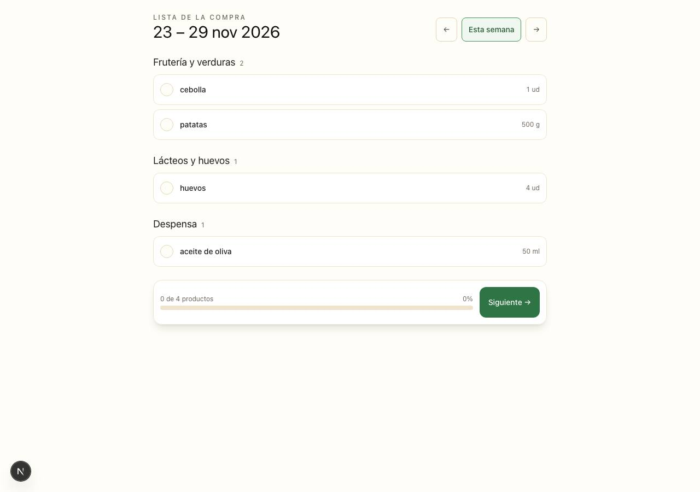
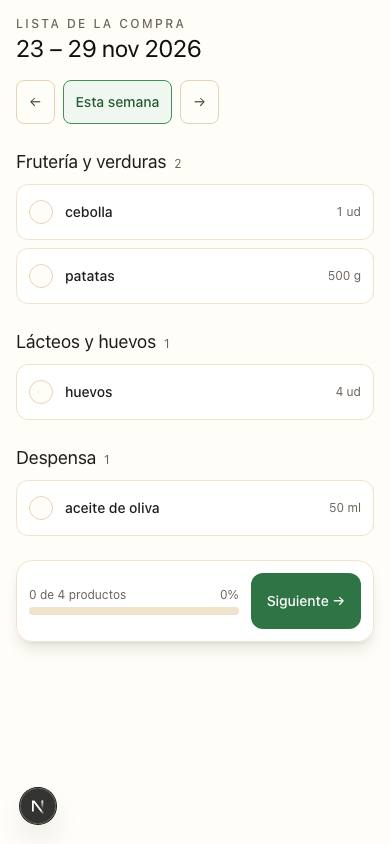

# Recipe Planner

Recipe Planner es la aplicación de cocina de un hogar compartido: las personas que viven juntas
guardan sus recetas en un único sitio, con foto, ingredientes, pasos y raciones, en lugar de
tenerlas repartidas entre capturas de pantalla, enlaces y notas sueltas. Cada receta pertenece a
un hogar, así que quien entra a la casa encuentra la colección común desde el primer día, y puede
importar una receta desde una URL para traerla con sus ingredientes ya estructurados en lugar de
copiarla a mano.

Sobre esa colección se apoya la semana: se asigna una receta a cada comida del calendario, se
escalan las raciones y se genera una lista de la compra que agrega los ingredientes de todo el
plan, descuenta lo que ya hay en la despensa y se comparte en tiempo real. Cuando alguien marca un
ítem en el supermercado, el resto de los móviles del hogar lo ve al instante, sin recargar ni
pisarse entre ellos.

## Stack

| Pieza          | Tecnología                                                                                                                                    | Qué se practica                                                                            |
| -------------- | --------------------------------------------------------------------------------------------------------------------------------------------- | ------------------------------------------------------------------------------------------ |
| Runtime        | Node.js 22 + TypeScript                                                                                                                       |                                                                                            |
| Framework      | NestJS 12 (adaptador **Fastify**)                                                                                                             | Módulos, providers, guards, pipes, interceptors                                            |
| Base de datos  | **MongoDB 7** (replica set de un nodo) + Mongoose                                                                                             | Documentos, índices, transacciones multi-documento                                         |
| Caché / colas  | Redis 7 + **BullMQ** (`@nestjs/bullmq`)                                                                                                       | Trabajos en segundo plano con reintentos                                                   |
| Archivos       | **MinIO** (compatible con S3) + URLs prefirmadas                                                                                              | Subidas directas desde el navegador                                                        |
| Validación     | `class-validator` + `class-transformer` (`ValidationPipe` global)                                                                             |                                                                                            |
| Auth           | Email + contraseña (`argon2`) + **JWT de acceso corto + refresh token rotatorio** con detección de reutilización, ambos en cookies `httpOnly` | Sesiones que sobreviven a la caducidad del access token sin guardar tokens en el navegador |
| Tiempo real    | Socket.IO (`@nestjs/websockets`) con adaptador de Redis                                                                                       | Salas por hogar                                                                            |
| Docs API       | `@nestjs/swagger`                                                                                                                             |                                                                                            |
| Rate limiting  | `@nestjs/throttler` con almacenamiento en Redis                                                                                               |                                                                                            |
| Logging        | `nestjs-pino`                                                                                                                                 |                                                                                            |
| Tests backend  | Vitest + Supertest + Testcontainers (Mongo y Redis)                                                                                           |                                                                                            |
| Frontend       | **Next.js 15** (App Router, React Server Components, Server Actions) + React 19 + Tailwind 4                                                  | SSR y streaming                                                                            |
| Estado cliente | TanStack Query solo en las partes interactivas                                                                                                |                                                                                            |
| Tests frontend | Vitest + React Testing Library                                                                                                                |                                                                                            |
| E2E            | Playwright                                                                                                                                    |                                                                                            |
| Contenedores   | Docker Compose (dev, test, e2e, prod con `output: 'standalone'`)                                                                              |                                                                                            |

## Capas de prueba

Cuatro capas de testing, desde unitarios hasta integración completa con contenedores:

| Capa                    | Comandos                              | Descripción                                                                                               |
| ----------------------- | ------------------------------------- | --------------------------------------------------------------------------------------------------------- |
| **Unit tests API**      | `npm run test:unit -w backend`        | Unitarios con Vitest. Umbrales: 80% líneas, ramas, functions y statements. Cobertura en `coverage/unit/`. |
| **Unit tests frontend** | `npm test -w frontend`                | Vitest + React Testing Library sobre componentes y helpers.                                               |
| **E2E API**             | `npm run test:e2e -w backend`         | Vitest + Supertest + Testcontainers (Mongo y Redis). Requiere Docker.                                     |
| **E2E navegador**       | `npm test -w e2e`                     | Playwright sobre `docker-compose.e2e.yml`: flujo crítico, tiempo real, accesibilidad, móvil y sesión.     |
| **Integration tests**   | `npm run test:integration -w backend` | Infraestructura real con Testcontainers. Requiere Docker.                                                 |
| **API contract**        | `npm run export:openapi -w backend`   | Regenera `packages/contracts/openapi.json`; CI falla si el export cambia el contrato versionado.          |

## Arranque

Requisitos: Node.js 22 y Docker con Compose (el repo usa OrbStack o Docker Desktop).

```bash
cp .env.example .env   # ajusta los secretos: los JWT necesitan 32+ caracteres
make up                # o: docker compose up --build --detach --wait
```

La primera vez se construyen las imágenes y se inicializan Mongo, MinIO y el bucket `recipes`.
Cuando el comando termina, la app está en <http://localhost:3001>.

| Servicio             | Puerto | Para qué                                                     |
| -------------------- | ------ | ------------------------------------------------------------ |
| Frontend (Next.js)   | 3001   | la aplicación                                                |
| API (NestJS/Fastify) | 3000   | rutas bajo `/api`                                            |
| MongoDB              | 27017  | base de datos con el replica set `rs0` (transacciones)       |
| Redis                | 6379   | caché, colas de BullMQ y adaptador de Socket.IO              |
| MinIO API (S3)       | 9000   | subidas directas y URLs prefirmadas                          |
| MinIO consola        | 9001   | consola web del almacenamiento (<http://localhost:9001>)     |
| Mailpit SMTP         | 1025   | correo saliente de desarrollo                                |
| Mailpit web          | 8025   | bandeja donde se leen esos correos (<http://localhost:8025>) |

Los atajos del día a día están en `make help`; la lista completa de comandos y de variables está
en las secciones siguientes.

Para levantar y verificar la pila de producción en local —Caddy con TLS interno, secretos,
healthchecks, URLs prefirmadas y apagado ordenado— sigue [`docs/production.md`](docs/production.md).

## Capturas

Tomadas sobre la pila E2E con datos de prueba creados para la ocasión (Chromium a 1280 × 900,
salvo la móvil):

**Detalle de receta** — Server Component con datos del hogar, ingredientes y pasos:



**Modo cocina** — única isla cliente del detalle, cargada solo al abrirla:



**Plan semanal** — receta asignada al hueco de la comida del lunes:



**Lista de la compra** — ingredientes agregados y agrupados por pasillo:



**Lista de la compra en móvil** — a 390 px, con el progreso y el salto al pendiente al alcance del
pulgar:



## Comandos útiles

| Comando                                                          | Qué hace                                                                                     |
| ---------------------------------------------------------------- | -------------------------------------------------------------------------------------------- |
| `make help`                                                      | Lista todos los atajos del Makefile.                                                         |
| `make up` / `make down`                                          | Levanta o para la pila de desarrollo (conserva los volúmenes).                               |
| `make logs`                                                      | Sigue los logs de todos los servicios.                                                       |
| `make seed`                                                      | Carga los datos de ejemplo descritos más abajo.                                              |
| `make migrate`                                                   | Rellena con `UTC` la zona horaria de los hogares creados antes de existir el campo.          |
| `make test` / `make test-frontend`                               | Unitarios de la API y del frontend.                                                          |
| `make test-e2e`                                                  | E2E de la API y del navegador.                                                               |
| `make test-integration`                                          | Tests con Testcontainers (necesita Docker).                                                  |
| `make lint` / `make format`                                      | ESLint y Prettier: comprobar / aplicar.                                                      |
| `npm run typecheck`                                              | Typecheck de `contracts`, backend, frontend y e2e.                                           |
| `npm run build`                                                  | Compila `contracts` y todos los workspaces en orden.                                         |
| `npm run format:check`                                           | Comprueba Prettier en todo el repo.                                                          |
| `npm run start:dev -w backend`                                   | API en modo watch, sin contenedores.                                                         |
| `npm run dev -w frontend -- -p 3001`                             | Next en desarrollo; el puerto evita chocar con la API en el 3000.                            |
| `npm run analyze -w frontend`                                    | Genera el informe de `@next/bundle-analyzer` en `frontend/.next/analyze/client.html`.        |
| `npm run measure:lighthouse -w e2e -- <url>`                     | Lighthouse sobre una URL ya servida; para rutas privadas pasa cookies con `--extra-headers`. |
| `npm run generate:api-types -w frontend`                         | Regenera `src/server/openapi.d.ts` desde `packages/contracts/openapi.json`.                  |
| `npm run report -w e2e`                                          | Abre el informe de Playwright de la última ejecución.                                        |
| `docker compose -f docker-compose.e2e.yml up -d --wait`          | Levanta la pila E2E completa, incluido el servidor de fixtures.                              |
| `docker compose -f docker-compose.e2e.yml down --remove-orphans` | Baja la pila E2E y limpia huérfanos.                                                         |

## Variables de entorno

El backend valida la configuración al arrancar: si falta alguna de las 16 variables obligatorias,
la API no levanta y el error lista los campos inválidos. `cp .env.example .env` deja los valores de
desarrollo; la pila E2E y el despliegue tienen sus propios valores.

### Backend: obligatorias

| Variable                           | Para qué                                             | Desarrollo                                       |
| ---------------------------------- | ---------------------------------------------------- | ------------------------------------------------ |
| `MONGO_URL`                        | MongoDB con replica set `rs0`                        | `mongodb://mongo:27017/recipes?replicaSet=rs0`   |
| `REDIS_URL`                        | Redis para colas, caché y Socket.IO                  | `redis://redis:6379`                             |
| `S3_ENDPOINT`                      | Endpoint interno de MinIO/S3                         | `http://minio:9000`                              |
| `S3_PUBLIC_ENDPOINT`               | Host que se firma en las URLs del navegador          | `http://localhost:9000`                          |
| `S3_BUCKET`                        | Bucket de imágenes                                   | `recipes`                                        |
| `S3_ACCESS_KEY` **(secreto)**      | Credencial S3                                        | `minioadmin` solo en local                       |
| `S3_SECRET_KEY` **(secreto)**      | Credencial S3                                        | `minioadmin` solo en local                       |
| `JWT_ACCESS_SECRET` **(secreto)**  | Firma HS256 del access token (mínimo 32 caracteres)  | valor de ejemplo en `.env.example`               |
| `JWT_REFRESH_SECRET` **(secreto)** | Firma HS256 del refresh token (mínimo 32 caracteres) | valor de ejemplo en `.env.example`               |
| `SMTP_HOST`                        | Host SMTP                                            | `mailpit`                                        |
| `SMTP_PORT`                        | Puerto SMTP; la validación lo exige pese al fallback | `1025`                                           |
| `MAIL_FROM`                        | Remitente de los correos                             | `Recipe Planner <no-reply@recipe-planner.local>` |
| `APP_ENV`                          | `development`, `test` o `production`                 | `development`                                    |
| `LOG_LEVEL`                        | `debug`, `info`, `warn` o `error`                    | `debug`                                          |
| `FRONTEND_URL`                     | Origen exacto de CORS, CSRF, sockets y correos       | `http://localhost:3001`                          |
| `API_INTERNAL_URL`                 | URL servidor→servidor que usa el frontend            | `http://backend:3000`                            |

### Backend: opcionales y de test

| Variable                                        | Para qué                                                    | Valor por defecto                      |
| ----------------------------------------------- | ----------------------------------------------------------- | -------------------------------------- |
| `NODE_ENV`                                      | Swagger UI frente a `/json`, y modo del export OpenAPI      | `development`                          |
| `PORT`                                          | Puerto HTTP de la API                                       | `3000`                                 |
| `PUBLIC_URL`                                    | URL del servidor en el documento OpenAPI                    | `http://localhost:3000`                |
| `TRUST_PROXY`                                   | CIDR aceptado para `X-Forwarded-For` (nunca `true`)         | `172.16.0.0/12`                        |
| `IMPORT_ALLOWED_HOSTS`                          | Whitelist CSV para importación, **solo con `APP_ENV=test`** | vacía; `fixtures` en E2E               |
| `OBSERVE_APP_KEY` / `OBSERVE_APP_SECRET`        | Credenciales de NestJS Observe (secretos)                   | las escribe `npx @nestjs/observe link` |
| `TESTCONTAINERS_MONGO` / `TESTCONTAINERS_REDIS` | Usar Testcontainers en tests de integración                 | solo tests                             |
| `MINIO_IMAGE`                                   | Imagen de MinIO en tests de integración                     | `chainguard/minio:latest`              |

### Frontend

| Variable              | Para qué                                                       | Valor                                                    |
| --------------------- | -------------------------------------------------------------- | -------------------------------------------------------- |
| `API_INTERNAL_URL`    | Base de `apiFetch` en el servidor y destino del rewrite `/api` | `http://backend:3000`; `localhost:3000` sin contenedores |
| `FRONTEND_URL`        | Cabecera `Origin` del refresh desde el middleware              | `http://localhost:3001`                                  |
| `NEXT_PUBLIC_API_URL` | Origen del handshake de Socket.IO; se incrusta en el build     | `http://localhost:3000`; vacío en producción             |
| `ANALYZE`             | `true` activa `@next/bundle-analyzer`                          | no definida                                              |

### E2E y producción

| Variable                | Para qué                                       | Valor                    |
| ----------------------- | ---------------------------------------------- | ------------------------ |
| `E2E_BASE_URL`          | URL del frontend para Playwright               | `http://localhost:3001`  |
| `E2E_API_URL`           | URL de la API para los helpers de datos        | `http://localhost:3000`  |
| `E2E_JWT_ACCESS_SECRET` | Firma de tokens en el test de sesión           | valor de test            |
| `CI`                    | Ajusta retries y workers de Playwright         | la define GitHub Actions |
| `APP_DOMAIN`            | Dominio de Caddy y URLs públicas en producción | `recipes.local`          |
| `MONGO_ROOT_USERNAME`   | Usuario root de Mongo en producción            | `recipes`                |

En producción los secretos se entregan como Docker secrets: `MONGO_URL_FILE`, `REDIS_URL_FILE`,
`S3_ACCESS_KEY_FILE`, `S3_SECRET_KEY_FILE`, `JWT_ACCESS_SECRET_FILE` y
`JWT_REFRESH_SECRET_FILE` leen su contenido de `/run/secrets/`. Si además existe la variable plana,
**el valor plano gana**. Los nombres de los ficheros y el resto de secretos del stack están en
`secrets/README.md` y `docs/production.md`.

## Datos de ejemplo

`npm run seed` (o `make seed` con la pila levantada) rellena la base de datos con un hogar de
prueba: dos usuarios que comparten casa, 25 recetas con ingredientes y pasos, el plan de la semana
en curso y una despensa básica.

| Usuario            | Contraseña    | Rol en el hogar |
| ------------------ | ------------- | --------------- |
| `ana@example.com`  | `Recetas123!` | propietaria     |
| `luis@example.com` | `Recetas123!` | miembro         |

El script se conecta con la `MONGO_URL` del entorno. Para ejecutarlo desde el host hace falta un
`.env` con una URL accesible (por ejemplo, `MONGO_URL=mongodb://localhost:27017/recipes?replicaSet=rs0`
con Mongo publicado en el 27017); dentro de Docker la variable ya apunta al servicio `mongo`.

Es idempotente: los usuarios se buscan por correo, el hogar por nombre y las recetas por título, así
que se puede ejecutar varias veces sin duplicar datos. El plan de la semana y la despensa se
actualizan con los valores del seed.
